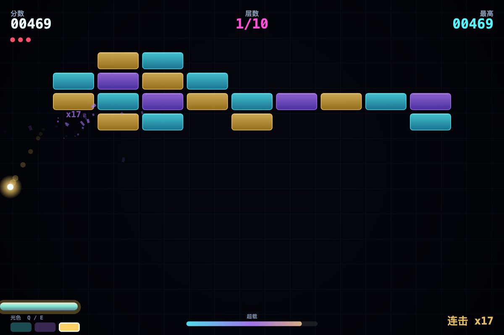

# PRISM BREAK · 棱镜爆破

一款塞进单个 HTML 文件的霓虹打砖块 Roguelike。零构建、零依赖、零素材 —— 每一块砖、每一张卡、每一个音效都由代码生成。

**在线玩：<https://prism.haohaop.com>** · 界面默认中文，菜单里可一键切英文



## 玩法核心：光色共鸣

大多数打砖块只要求你「接住球」。这里球带着一种**光色**（青 / 紫 / 金），每块砖也染着三种色之一。

**球色与砖色相同 → 伤害翻倍**，得分更高，超载槽充得更快。于是每一秒你都在做选择：追球，还是花半拍切个色去打对的那一列。

另外每层都混着特殊的砖：会**再生**的、被击中会**翻转你的光色**的、破了会**炸开邻居**的、永远不会碎的钢柱，还有会**整行左右漂移**的砖墙。

| 按键 | 动作 |
| --- | --- |
| `Q` / `E` | 切换光色（也可点左下角色块） |
| `1` `2` `3` | 直接跳到某一种色 |
| `SHIFT` | 充满后释放**超载爆发** |
| 鼠标 / 方向键 | 移动挡板（手机上是按住拖动） |
| 点击 / 空格 | 发球 |
| `P` | 暂停 · `M` 静音 · `L` 中英切换 |

## 超载

每破一块砖都给底部能量条充能。充满时按 `SHIFT` 释放棱镜爆发：全场砖块同时掉血，屏幕闪白，时间降到三分之一速度让你重新站位。一层密集砖块可以一键清空 —— 也可以留到金色核心棱镜。

## 结构

- **10 层**，每层图案不同、砖块血量递增，越深越有钢柱挡住你的舒适路线。
- **每 5 层**出现金色核心棱镜，外面套着三片护盾；护盾不破，核心免疫。
- **打完第 10 层**触发结局，之后可继续进入无尽模式。
- **21 张强化卡**，清层后三选一：多球、加宽、穿透、爆破、自动激光、暴击、护盾、缓冲、寻踪、分裂、共鸣增幅……以及三张**风险卡**（玻璃 / 狂战 / 易爆），换来高伤害但付出代价。

一局 5～15 分钟。

## 成就与统计

标题界面会记住你的累计局数、破砖总数与成就进度。五个成就：击碎核心、连击 25、一击 12 块、下潜 15 层、千砖。全部本地存档，不上传任何数据。

## 装到手机

用手机浏览器打开站点，菜单里可以「添加到主屏幕」—— 带 manifest 与图标，启动后是全屏横屏，没有地址栏。触摸是**相对拖动**：手指在屏幕任意位置滑动即可，不会挡住挡板。

## 本地运行

```bash
git clone https://github.com/HaoHaoP/prism-break.git
cd prism-break
open index.html          # macOS
# 或 python3 -m http.server 8080
```

`index.html` 自包含，也可以只下载这一个文件双击打开。

---

# English

A neon brick-breaker roguelike in a single HTML file. No build step, no dependencies, no assets.

**Play: <https://prism.haohaop.com>** — Chinese UI by default, `L` or the menu button switches to English.

## The twist: light tones

The ball carries one of three light tones — cyan, violet, amber — and every brick is tinted with one of the same three. Hitting a matching brick deals **double damage**, scores more and charges your overdrive faster.

Floors also mix in **regenerating** bricks, **prism cores** that flip your tone on contact, **bombs** that chain to neighbours, indestructible steel struts, and rows that **drift sideways**.

## Overdrive

Breaking bricks charges the meter. At full, `SHIFT` fires a prism burst: every brick takes a hit, the screen flashes, and time drops to a third speed so you can reposition.

## Structure

- 10 floors, each with a generated layout, growing brick health and drifting rows.
- Every 5th floor spawns a golden core prism guarded by three shield plates — the core is immune until they are gone.
- Clear floor 10 for the ending, then continue into endless mode.
- 21 upgrades, three at a time: extra balls, wider paddle, pierce, blast, auto-lasers, crits, shields, cushion, seeker, fork, resonance amp — plus three **risk** cards that trade safety for damage.

## Stats and achievements

The title screen tracks lifetime runs, bricks broken and five achievements (clear the core, a 25 combo, a 12-brick burst, floor 15, a thousand bricks). Everything stays in `localStorage` — nothing is uploaded.

## On a phone

Open the site on a mobile browser and add it to the home screen: the web app manifest plus icons give a full-screen landscape launch with no address bar. Touch control is **relative dragging** — slide anywhere on the screen and the paddle follows, so your thumb never covers it.

## Controls

| Key | Action |
| --- | --- |
| `Q` / `E` | shift light tone |
| `1` `2` `3` | jump to a tone |
| `Shift` | spend a full overdrive meter |
| mouse / arrows | move paddle |
| click / space | launch ball |
| `P` pause · `M` mute · `L` language | |

## How it is built

- Plain JavaScript, `requestAnimationFrame`, no framework, no bundler.
- Canvas 2D at a fixed 960×640 logical resolution, letterboxed and DPR-aware.
- Swept sub-stepping for collision so a fast ball never tunnels through a thin brick, plus anti-stall logic that re-aims a ball grazing empty space.
- Sound is synthesised live with WebAudio oscillators — there are no audio files in this repo.
- Best score and deepest floor persist in `localStorage`; the UI language does too.

## License

MIT. Fork it, reskin it, ship it.
